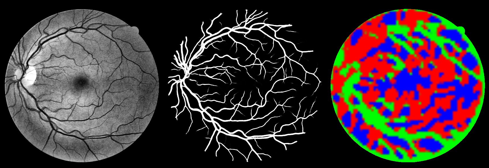

# DRIVE: fixing router collapse (step 1)

**Bottom line**

* The anti-collapse recipe works as intended. With the balance loss, sharpening, temperature annealing and branch
  dropout combined (`ac-full`), the router stops collapsing. It now picks a branch **per pixel**, makes decisive
  choices, uses all three branches, and its choices follow the vessel tree.
* **Segmentation did not improve.** `ac-full` is not significantly different from the collapsed CAT-Net-S on F1 or
  clDice. It is still significantly worse than the size-matched U-Net, by −0.0018 F1, at this budget.
* Router collapse was real, but it was **not** the reason CAT-Net-S trails the U-Net here.

## Setup

The schedule, data, split, seed, inference and model size are identical to [`../drive_cpu`](../drive_cpu/README.md):

* 24 epochs × 1000 patches of 128 px;
* batch size 8, learning rate 1e-3;
* 2 of the 20 training images held out for validation;
* 20 test images, metrics inside the FOV, threshold 0.5;
* flip TTA.

All runs use CAT-Net-S (2.94 M parameters). Only the routing options change:

| Run | Balance loss | Sharpening loss | τ schedule | Branch dropout |
|---|---|---|---|---|
| `catnet-s` (old run, collapsed) | – | – | 1 | – |
| `ac-drop` | – | – | 1 | 0.15 |
| `ac-balance` | 0.1 | – | 2 → 1 | – |
| `ac-full` | 0.1 | 0.02 | 2 → 1 | 0.15 |

What each option does:

* **Balance loss:** `n·Σ m_i² − 1`, where m_i is the mean weight of branch i over the batch. It is 0 for even use.
* **Sharpening loss:** mean per-pixel routing entropy divided by log n.
* **τ schedule:** the router's softmax temperature, annealed linearly over training.
* **Branch dropout:** per sample, zero one random branch and renormalise the remaining weights.

## Did routing become per-pixel?

These numbers are on the 20 test images, inside the FOV only. The weight columns list local / global / strip.

| Run | Block | Mean branch weights | Spatial std | Pixel entropy | Corr. with vessel density |
|---|---|---|---|---|---|
| `catnet-s` | 1/8 | 0.99 / 0.00 / 0.00 | 0.007 | ≈0 | – |
| | 1/16 | 0.02 / 0.98 / 0.00 | 0.024 | ≈0 | – |
| `ac-drop` | 1/8 | 0.79 / 0.00 / 0.21 | 0.188 | 0.27 | −0.37 / −0.30 / +0.37 |
| | 1/16 | 1.00 / 0.00 / 0.00 | 0.000 | 0.00 | – |
| `ac-balance` | 1/8 | 0.32 / 0.34 / 0.34 | 0.171 | 0.87 | +0.21 / −0.05 / −0.14 |
| | 1/16 | 0.37 / 0.32 / 0.31 | 0.073 | 0.97 | +0.17 / −0.30 / +0.13 |
| **`ac-full`** | 1/8 | 0.36 / 0.26 / 0.37 | **0.458** | **0.03** | +0.20 / +0.28 / **−0.44** |
| | 1/16 | 0.51 / 0.47 / 0.02 | **0.375** | **0.03** | **+0.41 / −0.39** / −0.07 |

How to read the columns:

* **Spatial std** is 0 when every pixel gets the same mix of branches.
* **Pixel entropy** is 0 when each pixel makes a hard choice and 1 when it splits evenly between branches.
* **Corr. with vessel density** is the Pearson correlation between each branch's weight and the vessel density in the
  same token. It is omitted where the weights barely vary.

What each option did on its own:

* **Branch dropout alone (`ac-drop`)** is not enough. The 1/16 stage still sends 100 % of its weight to local
  attention.
* **The balance loss alone (`ac-balance`)** stops the collapse but overshoots into the opposite failure: every pixel
  gets a nearly even ⅓/⅓/⅓ mix (entropy 0.87–0.97). That is almost the same as the no-router ablation.
* **Only the full recipe** gives routing that is balanced across the dataset and decisive at each pixel. Spatial std
  goes from 0.007 to 0.46 at 1/8 and from 0.024 to 0.38 at 1/16.

## Does the router respond to vessels, or to position?

I used [`scripts/routing_confounds.py`](../../scripts/routing_confounds.py) to regress each branch weight on three
per-token features: vessel density, distance from the FOV centre (pure position) and mean image intensity. It runs on
every token inside the FOV of all 20 test images. The table gives the R² for each feature alone, for `ac-full`.

| Block / branch | Vessel | Radius | Intensity | All three |
|---|---|---|---|---|
| 1/8 local | 0.04 | 0.01 | 0.01 | 0.05 |
| 1/8 global | 0.07 | 0.02 | 0.01 | 0.13 |
| 1/8 strip | **0.19** | 0.00 | 0.00 | 0.21 |
| 1/16 local | **0.17** | 0.00 | 0.01 | 0.20 |
| 1/16 global | **0.15** | 0.00 | 0.02 | 0.19 |
| 1/16 strip (barely used) | 0.00 | 0.04 | 0.00 | 0.05 |

* **Position explains almost nothing.** R² for radius is at most 0.04. Vessel density is the strongest of the three
  features for every branch that is actually used.
* **Most of the routing is still unexplained** (R² ≤ 0.21). Whatever drives the rest is not captured by these three
  simple features.
* **The collapsed run is not a counterexample.** It also shows R² ≈ 0.1–0.3 for vessel density, but its weights vary
  by only about 0.01, so in absolute terms its routing barely varies at all.

The figures show the test image, the prediction and the 1/8 routing map, coloured R = local, G = global, B = strip.

* [1/8 routing, image 1](figures/enc4.0/01_routing.png)
* [1/8 routing, image 2](figures/enc4.0/02_routing.png)
* [1/16 routing, image 1](figures/enc5.0/01_routing.png)
* [1/16 routing, image 2](figures/enc5.0/02_routing.png)

What the 1/8 map shows:

* **Global attention** (green) follows the major vessel arcades and the FOV rim.
* **The strip mixer** (blue) takes the vessel-free background between branches. Its correlation with vessel density
  is −0.44.
* **Local attention** (red) fills the remaining tissue around the smaller vessels.

The routing is structured, but not in the way the method's motivation suggested. Strip convolutions were meant to
handle elongated vessels, yet they are used mostly on background.

## Segmentation (20 DRIVE test images, mean over images, flip TTA)

| Model | Acc | Se | Sp | F1 | IoU | MCC | AUC | AP | clDice |
|---|---|---|---|---|---|---|---|---|---|
| U-Net | **0.9538** | 0.8464 | 0.9699 | **0.8227** | **0.6991** | **0.7979** | **0.9801** | **0.9128** | **0.8458** |
| CAT-Net-S, no router | **0.9538** | 0.8395 | **0.9709** | 0.8215 | 0.6973 | 0.7965 | 0.9790 | 0.9104 | 0.8409 |
| CAT-Net-S (collapsed) | 0.9535 | 0.8413 | 0.9702 | 0.8207 | 0.6962 | 0.7956 | 0.9790 | 0.9101 | 0.8418 |
| `ac-drop` | 0.9532 | 0.8445 | 0.9694 | 0.8205 | 0.6959 | 0.7953 | 0.9790 | 0.9103 | 0.8420 |
| `ac-balance` | 0.9535 | 0.8413 | 0.9702 | 0.8207 | 0.6961 | 0.7956 | 0.9790 | 0.9101 | 0.8417 |
| `ac-full` | 0.9535 | 0.8430 | 0.9699 | 0.8210 | 0.6965 | 0.7959 | 0.9792 | 0.9107 | 0.8418 |

These are paired Wilcoxon signed-rank tests over the 20 test images. Δ is the mean of row minus column, and "wins" is
the number of images on which the row model scores higher.

| Comparison | F1 Δ (wins, p) | AUC Δ (wins, p) | clDice Δ (wins, p) |
|---|---|---|---|
| `ac-full` vs U-Net | −0.0018 (3/20, p < 0.001) | −0.0010 (0/20, p < 10⁻⁵) | −0.0040 (2/20, p < 10⁻⁴) |
| `ac-full` vs CAT-Net-S | +0.0002 (12/20, p = 0.31) | +0.0002 (16/20, p = 0.009) | 0.0000 (9/20, p = 0.93) |
| `ac-balance` vs CAT-Net-S | 0.0000 (9/20, p = 0.70) | 0.0000 (10/20, p = 0.62) | −0.0001 (10/20, p = 0.60) |
| `ac-drop` vs CAT-Net-S | −0.0002 (10/20, p = 0.57) | 0.0000 (9/20, p = 0.76) | +0.0002 (10/20, p = 0.73) |

* `ac-full` gives a small but consistent AUC gain over the collapsed model: higher on 16 of 20 images. The size,
  +0.0002, is far below anything that matters in practice.
* F1 and clDice do not change.
* The gap to the U-Net is unchanged.

## What this means and what to try next

1. **The router fix is worth keeping.** It costs nothing and makes the "context-adaptive" claim measurably true. Use
   `--model catnet-s-ac --router-balance 0.1 --router-entropy 0.02 --router-tau-start 2 --router-tau-end 1`.
2. **Routing is not the bottleneck at this budget.** None of the routing variants differ, and the no-router ablation is
   within 0.001 F1 of all of them. Most of the segmentation quality comes from the convolutional stages at 1/1–1/4.
   The CAT stages work at 1/8 and 1/16, where DRIVE capillaries (1–3 px) no longer exist as separate tokens.
3. **Next experiments, in order of expected value:**
   * **More training, on GPU.** Transformers usually need longer schedules than CNNs. With 3 % of the planned schedule,
     the comparison with the U-Net is biased against the attention blocks.
   * **A CAT block at 1/4 resolution**, so routing acts where thin vessels are still resolved. This needs a small
     change to `CATNet`, which currently places CAT stages only at 1/8 and 1/16.
   * **Several seeds.** Every difference measured here between CAT-Net variants is about 0.001 F1, close to typical
     seed-to-seed noise. A single seed cannot rank them.
   * **Cross-dataset tests** (train on DRIVE, test on CHASE_DB1 or STARE). This is where image-level adaptivity (FiLM,
     global router head) should help most, and in-domain DRIVE cannot show it.

## Files

* `<run>/config.json`, `history.json`, `train.log`: the training configuration and logs.
* `<run>/metrics.json`: TTA test metrics, with per-image scores.
* `<run>/test_metrics_no_tta.json`: test metrics without TTA, with the routing report.
* `<run>/routing_report.json`: per-block usage, spatial std, entropy and vessel correlation.
* `<run>.confounds.json`: R² of the routing against vessel density, radius and intensity.
* `../drive_cpu/catnet-s/confounds.json`: the same analysis for the collapsed model.
* `figures/enc{4,5}.0/*.png`: routing maps.
