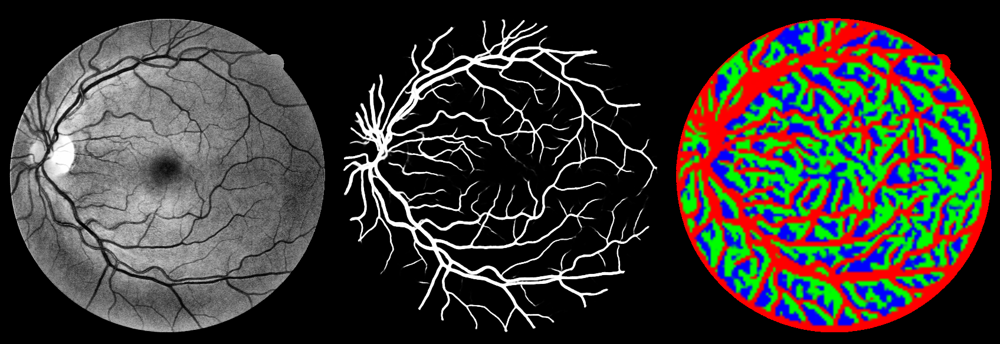

# DRIVE: a CAT block at 1/4 resolution (step 2)

**Question:** does a CAT block at 1/4 resolution help segmentation? This is where thin vessels are still resolved as
separate tokens.

**Bottom line**

* **The routing at 1/4 follows the vessel tree.** The local-attention weight correlates with vessel density at
  r = 0.70, and vessel density alone explains 48 % of its variance. Position and intensity explain almost nothing.
  The router learns a clean vessel / background split ([figure](figures/enc3.0/01_routing.png)).
* **Segmentation still does not improve.** `q-full` is within seed noise of `ac-full`, which has no 1/4 block, and
  is significantly worse than the U-Net.
* **It shifts errors rather than reducing them.** Adaptive routing at 1/4 trades F1 for vessel connectivity. Compared
  with the same model using a fixed equal mix of branches:
  * clDice is higher on 18 of 20 images (+0.003, p < 10⁻⁴);
  * F1 is lower (−0.001, p = 0.002);
  * AUC and AP are unchanged.

  So the model favours sensitivity at the 0.5 threshold. It does not rank pixels any better.

## Setup

The schedule is identical to [`../drive_cpu`](../drive_cpu/README.md) and [`../drive_ac`](../drive_ac/README.md):

* 24 epochs × 1000 patches of 128 px;
* batch size 8, CPU, 1 thread per run;
* the same 2 validation images;
* 20 test images, metrics inside the FOV, threshold 0.5;
* flip TTA.

| Run | Model | Params | Routing |
|---|---|---|---|
| `q-full` | `catnet-s-q`: `catnet-s-ac` + 1 CAT block at 1/4 (64 ch, 2 heads) | 3.09 M | adaptive, full anti-collapse recipe¹ |
| `q-norouter` | same, router disabled (`adaptive_routing=false`, no branch dropout) | 3.05 M | fixed equal mix |
| `ac-full-seed7` | `ac-full` from step 1 with seed 7 (same validation split via `--split-seed 42`) | 2.94 M | adaptive, full recipe |

¹ `--router-balance 0.1 --router-entropy 0.02 --router-tau-start 2 --router-tau-end 1`, with branch dropout 0.15.

`ac-full-seed7` measures **seed-to-seed noise**. Without it, differences of about 0.001 cannot be interpreted.

## Segmentation (20 DRIVE test images, mean over images, flip TTA)

| Model | Acc | Se | Sp | F1 | IoU | MCC | AUC | AP | clDice |
|---|---|---|---|---|---|---|---|---|---|
| U-Net | **0.9538** | 0.8464 | 0.9699 | **0.8227** | **0.6991** | **0.7979** | **0.9801** | **0.9128** | **0.8458** |
| CAT-Net-S, no router (step 0) | **0.9538** | 0.8395 | **0.9709** | 0.8215 | 0.6973 | 0.7965 | 0.9790 | 0.9104 | 0.8409 |
| `ac-full` (seed 42) | 0.9535 | 0.8430 | 0.9699 | 0.8210 | 0.6965 | 0.7959 | 0.9792 | 0.9107 | 0.8418 |
| `ac-full-seed7` | 0.9531 | **0.8468** | 0.9690 | 0.8206 | 0.6959 | 0.7954 | 0.9790 | 0.9103 | 0.8429 |
| `q-norouter` | 0.9535 | 0.8414 | 0.9702 | 0.8209 | 0.6964 | 0.7958 | 0.9788 | 0.9101 | 0.8404 |
| `q-full` | 0.9529 | **0.8468** | 0.9687 | 0.8197 | 0.6947 | 0.7944 | 0.9789 | 0.9099 | 0.8435 |

These are paired Wilcoxon signed-rank tests over the 20 test images. Δ is the mean of row minus column, and "wins" is
the number of images on which the row model scores higher.

| Comparison | F1 Δ (wins, p) | AUC Δ (wins, p) | clDice Δ (wins, p) |
|---|---|---|---|
| `ac-full-seed7` vs `ac-full` (**seed noise**) | −0.0004 (7/20, 0.29) | −0.0001 (6/20, 0.19) | +0.0011 (13/20, 0.09) |
| `q-full` vs `ac-full` | −0.0013 (5/20, 0.02) | −0.0003 (7/20, 0.007) | +0.0017 (16/20, 0.01) |
| `q-full` vs `ac-full-seed7` | −0.0009 (6/20, 0.06) | −0.0002 (9/20, 0.35) | +0.0006 (11/20, 0.25) |
| `q-full` vs `q-norouter` | −0.0012 (4/20, 0.002) | +0.0001 (11/20, 0.60) | **+0.0032 (18/20, < 10⁻⁴)** |
| `q-full` vs U-Net | −0.0030 (2/20, < 10⁻⁴) | −0.0013 (1/20, < 10⁻⁵) | −0.0023 (6/20, 0.01) |
| `q-norouter` vs U-Net | −0.0018 (2/20, < 10⁻³) | −0.0013 (0/20, < 10⁻⁵) | −0.0054 (0/20, < 10⁻⁵) |

How to read these:

* **Seed noise is about 0.0004 F1 and 0.001 clDice** on the mean. Per image, the two seeds differ by about 0.001 F1
  on average.
* **Comparisons against a single seed can mislead.** `q-full` vs `ac-full` looks significant (p = 0.02), but against
  the other `ac-full` seed the same comparison is not (p = 0.06). Both p-values treat the training run as fixed, so
  they understate the real uncertainty.
* **The routing effect is the most robust result in this table.** Adaptive routing at 1/4 raises Se and clDice and
  lowers Sp and F1, while AUC and AP stay the same. The effect is consistent across images, 18 of 20 for clDice. It
  is a change in the operating point: more thin-vessel pixels pass the 0.5 threshold, which joins up the skeleton but
  adds false positives. It does not make the model discriminate vessels better.
* **The gap to the U-Net remains**, in every metric and for every CAT-Net variant.

## Routing at 1/4: what does the router respond to?

These numbers are for `q-full` on the test images, inside the FOV only. The weight and correlation columns list
local / global / strip.

| Block | Mean branch weights | Spatial std | Pixel entropy | Corr. with vessel density |
|---|---|---|---|---|
| 1/4 (new) | 0.28 / 0.33 / 0.40 | 0.453 | 0.05 | **+0.70** / −0.28 / −0.37 |
| 1/8 | 0.40 / 0.37 / 0.23 | 0.456 | 0.03 | −0.46 / +0.41 / +0.06 |
| 1/16 | 0.49 / 0.33 / 0.18 | 0.442 | 0.04 | −0.23 / +0.31 / −0.07 |

This is the R² of each branch weight regressed on one feature at a time, from
[`scripts/routing_confounds.py`](../../scripts/routing_confounds.py):

| Block / branch | Vessel | Radius | Intensity |
|---|---|---|---|
| 1/4 local | **0.48** | 0.00 | 0.07 |
| 1/4 global | 0.08 | 0.01 | 0.00 |
| 1/4 strip | 0.14 | 0.00 | 0.05 |
| 1/8 local | 0.21 | 0.00 | 0.00 |
| 1/8 global | 0.17 | 0.00 | 0.01 |

What the 1/4 routing map shows:

* **Local window attention** (red) is assigned to vessel pixels and traces the whole vessel tree, down to fairly thin
  branches.
* **Global grid attention** (green) and **the strip mixer** (blue) split the background between them in a patchy
  pattern.
* **Position plays no role:** R² for radius is at most 0.01.

**Which branch handles vessels is not stable across seeds.** At 1/8:

* in `ac-full` (seed 42), the strip mixer avoids vessels (r = −0.44);
* in `ac-full-seed7`, local attention takes the vessels (r = +0.64, R² 0.41);
* in `q-full`, local attention avoids them (r = −0.46).

What is stable is that the router separates **vessel tokens from background tokens**. Which branch it gives to which
group is arbitrary. The three branches seem to be interchangeable to the network, which fits with routing not
changing AUC.

## Conclusions after steps 1 and 2

1. **The CAT router works as a mechanism.** With the anti-collapse recipe, it makes decisive per-pixel choices that
   track the vessels, not position. At 1/4 resolution its routing map is close to a coarse vessel segmentation.
2. **At this budget, that structure does not improve segmentation.**
   * Five CAT-Net-S variants differ by ≤ 0.0013 F1 from one another, which is close to seed noise.
   * All of them are significantly worse than a size-matched residual U-Net, by about 0.002–0.003 F1 and 0.001 AUC.
   * The one reproducible effect of routing, at 1/4, is better vessel connectivity: clDice +0.003. It comes from a
     more sensitive operating point, not from better discrimination.
3. **What is still untested** is whether the conclusion changes with:
   * a **full training schedule** — 3 % of the planned schedule may not be enough for attention blocks to pay off,
     and this needs a GPU;
   * **cross-dataset testing** (DRIVE → CHASE_DB1 / STARE), where image-level adaptivity should matter most.

   The CHASE_DB1 and STARE loaders exist. The data still needs to be fetched.

## Files

* `<run>/config.json`, `history.json`, `train.log`: the training configuration and logs.
* `<run>/metrics.json`: TTA test metrics, with per-image scores.
* `<run>/test_metrics_no_tta.json`: test metrics without TTA, with the routing report.
* `<run>/routing_report.json`: per-block usage, spatial std, entropy and vessel correlation.
* `<run>.confounds.json`: R² of the routing against vessel density, radius and intensity. `q-norouter` has no router,
  so it has no routing files.
* `figures/enc3.0/*.png`: routing maps at 1/4 for `q-full`.
